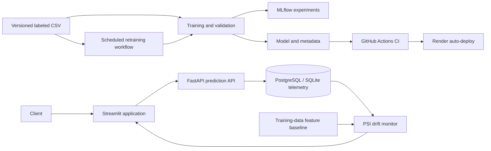

# Customer Churn Prediction Platform

An end-to-end MLOps source project for customer churn prediction. It provides a real-time prediction API, MLflow experiment tracking, prediction telemetry, feature-drift monitoring, a Streamlit dashboard, scheduled retraining, CI, Docker Compose, and a Render deployment blueprint. This public repository does not contain the Telco dataset, trained model, or generated reports; obtain authorized data and train a model locally before running the application.

## Architecture



## Run locally

Use Python 3.11 and PowerShell:

```powershell
python -m venv .venv
.\.venv\Scripts\Activate.ps1
python -m pip install -r requirements.txt
```

The training dataset is not included because the source listing does not provide a redistribution license. Review the terms and follow [data/README.md](./data/README.md) to provide an authorized copy at `data/telco_customer_churn.csv`. Then train the model:

```powershell
python src\train.py
```

Training creates the model and metadata under `models\`. Those artifacts and generated reports are ignored by Git; see [models/README.md](./models/README.md).

### Prepare private deployment artifacts

The API needs a trusted model, metadata, and a reference-feature baseline at runtime. Package these locally from an authorized dataset and trusted model; the package contains feature columns only, not customer IDs or churn labels:

```powershell
python -m src.package_model_artifacts `
  --dataset D:\path\to\authorized\telco_customer_churn.csv `
  --model D:\path\to\trusted\churn_model.joblib `
  --metadata D:\path\to\trusted\model_metadata.json `
  --output runtime\churn-model-bundle.tar.gz
```

The script prints the bundle's SHA-256. For a simple private GitHub-hosted option, upload `churn_model_bundle.tar.gz` to a **separate private repository**. Configure `MODEL_BUNDLE_URL` to the GitHub Contents API URL for the file (for example, `https://api.github.com/repos/OWNER/REPO/contents/churn_model_bundle.tar.gz?ref=main`) and configure `MODEL_BUNDLE_TOKEN` with a fine-grained GitHub token limited to read-only **Contents** access for that private repository. The downloader requests the raw-file media type and sends the token as a bearer credential. Configure `MODEL_BUNDLE_SHA256` to the packager's printed digest. Keep the bundle repository private; never put the model bundle or token in this public source repository. The API downloads the bundle at startup, verifies the configured SHA-256, rejects unexpected archive paths/files, and extracts only the three expected artifacts.

Run the API and dashboard in separate terminals:

```powershell
uvicorn app.main:app --reload
streamlit run dashboard.py
```

- API docs and prediction endpoint: `http://127.0.0.1:8000/docs`
- Health/readiness check (model and telemetry database): `http://127.0.0.1:8000/health`
- Monitoring metrics and feature drift: `http://127.0.0.1:8000/monitoring`
- Privacy-safe prediction history: `http://127.0.0.1:8000/prediction-history`
- Historical drift reports: `http://127.0.0.1:8000/drift-history`
- Dashboard: `http://localhost:8501`
- MLflow UI: `mlflow ui --backend-store-uri sqlite:///mlflow.db --host 127.0.0.1 --port 5000`

`POST /predict` accepts the 19 customer input features shown in the OpenAPI schema and returns a prediction ID, churn probability, class, and model version. Customer IDs are rejected and are not returned in history. The API retains a bounded history of model features (for drift calculation) and scores for up to 30 days (maximum 10,000 observations). The `/prediction-history` response exposes only prediction ID, time, predicted class, score, and model version. Configure `PREDICTION_DATABASE_URL` (or the platform-provided `DATABASE_URL`) to connect to PostgreSQL. A local SQLite file remains the fallback when running the API directly without a database URL.

The `/monitoring` endpoint compares the latest 1,000 prediction inputs with the training-data baseline using Population Stability Index (PSI). Drift is flagged at PSI >= 0.2; at least 30 observations are needed before feature-level PSI is reported. Each new prediction window evaluated after that minimum is reached is kept as a bounded historical drift report. API request counts, status-code errors, and response latency are collected for non-monitoring API requests and summarized over the last 24 hours. Drift monitoring currently uses the project's tested PSI implementation; Evidently is not integrated.

The Streamlit app has three views: an overview, an interactive customer-prediction form with privacy-safe recent history, and a separate MLOps monitor for request counts, response time, HTTP errors, prediction activity, PSI drift, model evaluation, and service health. When telemetry is empty, the prediction page can score a synthetic example. Use **Refresh metrics** on the monitoring page to fetch current API data. The API uses PostgreSQL in Docker Compose and SQLite for direct local runs and the free Render demo. Existing SQLite telemetry is not automatically migrated to PostgreSQL. Set `POSTGRES_PASSWORD` in a local `.env` file to replace Compose's development-only default; URL-encode special characters if the password contains them.

## Run with Docker Compose

```powershell
docker compose up --build
```

For local Compose, provide an authorized dataset, train a model into `models\`, and keep the local bundle URL unset; the API mounts `data\` and `models\` read-only. For a remote bundle, set `MODEL_BUNDLE_URL` and `MODEL_BUNDLE_SHA256` in a local `.env` and remove those two local bind mounts from the API service so the downloader can write to its artifact directory. Set `MODEL_BUNDLE_TOKEN` only when your private object-storage service requires bearer-token authentication. The API and dashboard are available at `http://localhost:8000` and `http://localhost:8501`. PostgreSQL stores prediction, API-request, and drift-report telemetry in the `postgres_data` Docker volume. The Compose database password is for local development only; change it using local environment configuration before sharing the Compose stack.

## No-card cloud demo with Streamlit Community Cloud

If you do not want to add a payment method to Render, the repository includes a **single-app demo** for Streamlit Community Cloud. It keeps the existing Streamlit views but performs model scoring and telemetry access in the Streamlit process instead of calling a separate FastAPI service. The regular FastAPI + Streamlit + PostgreSQL Docker Compose architecture is unchanged.

Deploy `streamlit_cloud/dashboard.py` from the public source repository, select Python 3.11, and add these values under the app's **Advanced settings → Secrets**. Streamlit uses the dedicated `streamlit_cloud/requirements.txt` dependency file next to the entrypoint.

```toml
MODEL_BUNDLE_URL = "https://api.github.com/repos/nipunidasanayake/customer-churn-model-artifacts/contents/churn_model_bundle.tar.gz?ref=main"
MODEL_BUNDLE_SHA256 = "e82d9b4e7a2a38c81fcdbc1015b475cb9555533c8a8d8979595b5a82770920f9"
MODEL_BUNDLE_TOKEN = "YOUR_FINE_GRAINED_READ_ONLY_TOKEN"
```

Create the token with access only to the private `customer-churn-model-artifacts` repository and **Contents: Read-only** permission. Never commit `secrets.toml`, the token, or the bundle. Streamlit Community Cloud runs this as a public demo unless you configure platform-supported access controls. The app warns users to use synthetic data only and limits each browser session to 20 prediction attempts. This session-level limit is not abuse-resistant rate limiting; visitors can start new sessions. The app does not expose a separate FastAPI endpoint; inference latency/error charts count only explicit in-app scoring attempts. Its SQLite history is ephemeral and may be lost on restart or app sleep. It has no authentication, durable telemetry, or production privacy controls and must not be used with real customer data.

## Training and experiment tracking

`src/train.py` compares Logistic Regression, Random Forest, and Gradient Boosting using a stratified validation sample from the development cohort. Stable SHA-256 buckets of customer IDs reserve disjoint development, promotion, and final test cohorts; promotion and test customers are excluded from model fitting. The automated non-regression gate compares candidate and champion F1 on the reserved promotion cohort. The final test metrics are calculated once after promotion and are not used to choose or promote models. The split scheme is recorded in metadata; an older champion without this metadata must first be replaced by a reviewed training run before automated promotion is enabled.

The scikit-learn version is pinned for model serialization compatibility, included in metadata, and checked when the API loads the artifact. Model files use Python pickle-compatible serialization; only load artifacts produced by a trusted training run.

Set `CHURN_DATA_PATH` to use a different labeled CSV and `MLFLOW_TRACKING_URI` to connect to a remote MLflow tracking server. The CSV must contain `customerID`, `TotalCharges`, and `Churn` as well as the model feature columns. The training script records the dataset SHA-256 in the model metadata.

GitHub Actions runs tests (including artifact validation and a PostgreSQL telemetry round-trip), validates Docker Compose, and builds both service images on pushes and pull requests using test fixtures. The scheduled retraining workflow skips when the dataset is absent; provide an authorized dataset through an appropriate private data source before enabling retraining. When data is supplied, the workflow checks for a changed data hash and only publishes a candidate that does not regress on the reserved promotion cohort. Configure the GitHub Actions secret `MLFLOW_TRACKING_URI` to persist automated-run experiment history in a remote MLflow server; without it, tracking remains in the short-lived runner.

**Real-world limitation:** the supplied Telco CSV is a static labeled sample. Real supervised retraining requires a governed process to deliver new, quality-checked labels into the training dataset; prediction requests alone are not labels and must never be treated as such. This project does not infer outcomes from unlabelled predictions.

## Render deployment

The `render.yaml` blueprint defines a **free demo** API and monitoring dashboard. It does not create a database or any paid service. The API uses SQLite on Render's ephemeral filesystem, so prediction history and monitoring telemetry are lost when the free service restarts, redeploys, or spins down after 15 minutes without traffic. Free services can also have cold starts and monthly usage limits; this configuration is for a demo, not production. For durable telemetry and always-on service, use a paid deployment only after reviewing and explicitly approving the applicable costs.

The public source repository does not include the dataset or trained model. Before creating services, upload the locally prepared bundle to a separate private GitHub repository (or another authorized private HTTPS host) and have its download URL and SHA-256 ready. For GitHub, use the Contents API URL and a fine-grained token with read-only Contents access restricted to the private artifact repository. Render prompts for `MODEL_BUNDLE_URL` and `MODEL_BUNDLE_SHA256` during Blueprint setup; add `MODEL_BUNDLE_TOKEN` as a secret environment variable. The URL must remain valid across service restarts because the free API downloads the bundle on each cold start. Do not commit restricted data, model artifacts, URLs, or tokens to this public source repository.

1. Push this project to a GitHub repository and connect that repository to Render.
2. Verify your Render account, then create a Render Blueprint from the repository and enter the private artifact bundle URL and checksum. The Blueprint uses free web services and no database; review Render's current free-tier limits before applying.
3. Confirm the API URL referenced by `API_URL` in `render.yaml` matches the URL Render assigns.
4. Configure the GitHub Actions workflow permissions to allow its retraining job to push model artifacts. Render auto-deploys commits to the connected branch.
5. After deployment, verify `/health`, `/docs`, and the dashboard URL.

The blueprint is configuration only; it does not create cloud resources until applied in a Render account. Render documents that free services are not for production: they spin down after 15 minutes of inactivity and have ephemeral filesystems, so local SQLite telemetry is not durable. This demonstration also has no authentication or rate limiting and must not be supplied with production customer data without those controls, TLS/routing review, access controls, and a privacy-retention review. Do not commit credentials.

## Validation

```powershell
pytest -q
docker compose config
```

The IBM Telco sample dataset may have redistribution terms; verify the source and license before using or redistributing it. The dataset and its trained artifact are excluded from this public repository.
