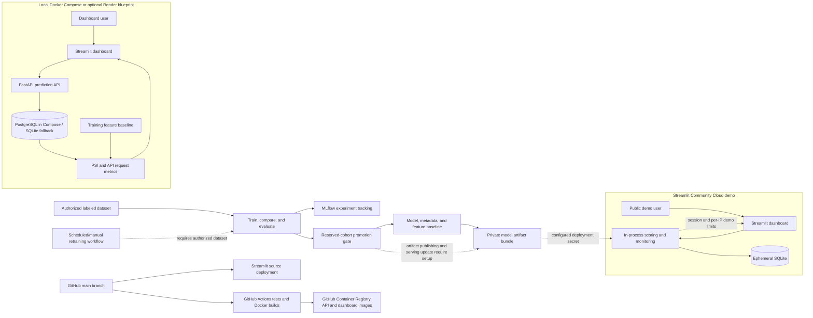

# Customer Churn Prediction Platform

An end-to-end MLOps demonstration for predicting customer churn. The repository includes model training and evaluation, an inference API, Streamlit dashboards, experiment tracking, prediction telemetry, PSI-based feature-drift monitoring, Docker Compose, GitHub Actions CI/CD to GitHub Container Registry, and a scheduled retraining workflow.

The public source repository intentionally excludes the training dataset and trained model artifacts. The live Streamlit Community Cloud app is a public demo and should only be used with synthetic data. This is a portfolio/demo platform, not a production-ready service for real customer data.

## Project status and deliverables

| Capability | Included | Notes |
|---|---|---|
| Real-time predictions | Yes | FastAPI `/predict` endpoint; the public Streamlit demo scores in-process and does not expose this API. |
| Model training and evaluation | Yes | Compares Logistic Regression, Random Forest, and Gradient Boosting; selects using validation F1 and reports a separate held-out test cohort. |
| Experiment tracking | Yes | MLflow; local runs use SQLite by default. Set `MLFLOW_TRACKING_URI` for a remote tracking server. |
| Model promotion check | Yes | The automated workflow can reject a candidate whose reserved-cohort F1 regresses against the champion. |
| Drift and service monitoring | Yes | PSI-based drift, prediction history, and API request metrics are available in the API-backed dashboard. |
| Dockerized application | Yes | Dockerfiles and Compose configuration run the API, dashboard, and PostgreSQL locally. |
| CI/CD | Yes | GitHub Actions tests and builds both Docker images, then publishes them to GitHub Container Registry (GHCR) after pushes to `main` or `master`. This delivers images; it does not deploy a running cloud service. Retrained model artifact publication is not wired. |
| Automated retraining | Conditional | A scheduled workflow exists, but the authorized dataset is absent by default and no private-data download is configured. See [Automated retraining limitations](#automated-retraining-limitations). |
| Live cloud demo | Yes | [Open the public Streamlit demo](https://customer-churn-mlops-epsoi8s3657qpcyjgxztbd.streamlit.app/). It uses ephemeral SQLite and lightweight in-process limits. |

## Architecture



The repository supports two different serving arrangements:

1. **Public Streamlit demo:** a single Streamlit Community Cloud app downloads the trusted private artifact bundle, performs scoring in the Streamlit process, and stores telemetry in temporary SQLite.
2. **API-backed stack:** a Streamlit dashboard calls FastAPI. Docker Compose runs PostgreSQL for telemetry; direct API runs and the optional Render blueprint use SQLite unless configured otherwise.

These deployment modes are alternatives, not one combined live system. The current public demo is the first mode; its prediction requests do not pass through the separate FastAPI service.

## Repository layout

| Path | Purpose |
|---|---|
| `app/` | FastAPI application and prediction endpoints |
| `src/` | Training, artifact packaging/loading, dashboard runtime, and monitoring logic |
| `dashboard.py`, `dashboard_common.py`, `pages/` | Streamlit views and shared dashboard helpers |
| `streamlit_cloud/` | Streamlit Community Cloud entrypoint and dependency list |
| `tests/` | API, dashboard runtime, monitoring, and artifact bundle tests |
| `.github/workflows/ci.yml` | Tests, Compose validation, and Docker image builds |
| `.github/workflows/retrain.yml` | Scheduled/manual retraining workflow |
| `Dockerfile`, `Dockerfile.dashboard`, `compose.yaml` | API, dashboard, and local stack configuration |
| `render.yaml` | Optional Render API/dashboard blueprint |
| `data/`, `models/`, `reports/` | Local input/generated artifacts; dataset and model outputs are excluded from Git |

## Requirements

- Python 3.11
- Git
- Docker Desktop with Docker Compose, if running the container stack
- An authorized copy of the labeled training data to train a model

The Telco churn dataset is not bundled. Review its source terms before obtaining, using, or redistributing it. See [data/README.md](./data/README.md).

## Train a model locally

In PowerShell, create and activate a virtual environment, install dependencies, and place an authorized CSV at `data\telco_customer_churn.csv`:

```powershell
python -m venv .venv
.\.venv\Scripts\Activate.ps1
python -m pip install -r requirements.txt
python src\train.py
```

The CSV must contain `customerID`, `TotalCharges`, `Churn`, and the 19 model feature columns. `customerID` is used to keep stable cohorts and is excluded from model features. Set `CHURN_DATA_PATH` to use a different local CSV path.

Training compares Logistic Regression, Random Forest, and Gradient Boosting. It selects a model using validation F1 from the development cohort, evaluates the candidate against the reserved promotion cohort, and calculates final test metrics after selection. Customer IDs are assigned to stable SHA-256 buckets for development, promotion, and test cohorts; promotion and test rows are excluded from fitting. Training records the dataset hash, split information, metrics, and scikit-learn version in metadata and logs the run to MLflow.

Generated model files and reports are ignored by Git. See [models/README.md](./models/README.md). Model files are joblib/pickle-compatible artifacts: only load files produced by a trusted training run.

To use a remote MLflow tracking server, set `MLFLOW_TRACKING_URI`. Without it, training defaults to local SQLite tracking (`mlflow.db`). Start the local MLflow UI with:

```powershell
mlflow ui --backend-store-uri sqlite:///mlflow.db --host 127.0.0.1 --port 5000
```

## Run the API and dashboard directly

After training has created model artifacts:

```powershell
uvicorn app.main:app --reload
```

In a second PowerShell terminal, activate the same virtual environment and run:

```powershell
streamlit run dashboard.py
```

The local dashboard is at `http://localhost:8501`. The API listens at `http://127.0.0.1:8000`.

| Endpoint | Purpose |
|---|---|
| `/health` | API, model, and telemetry-store health |
| `/docs` | Interactive OpenAPI documentation |
| `/model-info` | Loaded model metadata |
| `/predict` | `POST` churn prediction |
| `/monitoring` | Recent API metrics and feature drift |
| `/prediction-history` | Privacy-safe prediction history |
| `/drift-history` | Historical drift reports |

`POST /predict` accepts the model's input features and returns a prediction ID, churn probability, predicted class, and model version. Customer identifiers are not accepted as model inputs and are not included in prediction history.

The API-backed dashboard includes overview, prediction, and MLOps monitoring views. Its monitoring page presents request counts, response latency, HTTP errors, prediction activity, PSI drift, model evaluation, and service health.

## Telemetry and drift monitoring

The API compares recent prediction inputs with the training-data feature baseline using Population Stability Index (PSI). The report evaluates up to the latest 1,000 prediction inputs; at least 30 observations are required for feature-level reporting, and PSI values of 0.2 or greater are flagged as drift. Historical drift reports are bounded. API request counts, status-code errors, and response times are summarized over the preceding 24 hours. The dashboard uses the project's PSI implementation; Evidently is not integrated.

Telemetry retention is bounded to 30 days and at most 10,000 events per event collection. Configure `PREDICTION_DATABASE_URL` or `DATABASE_URL` to connect the API to PostgreSQL. Without a database URL, a local SQLite database is used. Existing SQLite records are not automatically migrated to PostgreSQL.

## Run with Docker Compose

The Compose stack starts PostgreSQL, the FastAPI service, and the Streamlit dashboard:

```powershell
docker compose up --build
```

The default Compose database password is for local development only. Before sharing the stack, set `POSTGRES_PASSWORD` in a local `.env` file and keep that file out of Git. Compose stores PostgreSQL data in the `postgres_data` volume. The API and dashboard expose ports 8000 and 8501, respectively.

The API container needs trusted model artifacts and a feature baseline. For a local run, first train the model into `models/`; Compose mounts `models/` read-only into the API container. Alternatively, configure a private artifact bundle using the variables below. Do not use public source control to distribute restricted datasets, model artifacts, or credentials.

## Package and host private model artifacts

The API and Streamlit Community Cloud entrypoint can load a bundle containing the trained model, metadata, and feature baseline. Package artifacts from trusted local inputs:

```powershell
python -m src.package_model_artifacts `
  --dataset D:\path\to\authorized\telco_customer_churn.csv `
  --model D:\path\to\trusted\churn_model.joblib `
  --metadata D:\path\to\trusted\model_metadata.json `
  --output runtime\churn-model-bundle.tar.gz
```

The command prints the bundle's SHA-256 checksum. Host the bundle on a private, authorized HTTPS location. For GitHub, use the Contents API URL of a separate private repository and a fine-grained token with read-only Contents permission limited to that repository.

Configure these environment variables or deployment secrets:

| Variable | Purpose |
|---|---|
| `MODEL_BUNDLE_URL` | Private bundle download URL |
| `MODEL_BUNDLE_SHA256` | Expected SHA-256 digest printed by the packaging command |
| `MODEL_BUNDLE_TOKEN` | Optional bearer token for the private artifact host |
| `MODEL_ARTIFACT_DIR` | Directory used to download/extract model files |

The artifact loader verifies the configured digest and restricts archive contents to the expected artifacts. Keep bundle URLs and credentials out of public code and logs. Never commit `.env`, Streamlit secrets, private artifacts, or tokens.

## Public Streamlit Community Cloud demo

The deployed public demo uses `streamlit_cloud/dashboard.py` as its entrypoint and Python 3.11. Its dedicated dependencies are in `streamlit_cloud/requirements.txt`. In the app's Streamlit Secrets settings, configure `MODEL_BUNDLE_URL`, `MODEL_BUNDLE_SHA256`, and `MODEL_BUNDLE_TOKEN`; do not place these values in the repository.

The demo is public and should only receive synthetic inputs. It warns users not to enter real customer or personally identifiable information. It allows up to 20 attempts per Streamlit session, plus an in-process IP limit of 10 attempts per 10 minutes and 50 per 24 hours. IP counters are HMAC-keyed in process memory; they reset when the app restarts, are not shared between app processes, and may be shared by users behind the same NAT. IP-based limits can also be evaded, so these are demo safeguards rather than robust abuse prevention.

The app's SQLite telemetry is ephemeral and may be lost when Streamlit Community Cloud restarts or sleeps the app. It has no authentication, durable telemetry, or production privacy controls. It scores predictions in-process and does not provide a separate FastAPI endpoint; its request charts therefore do not represent traffic to the FastAPI service.

## Automated retraining limitations

The scheduled workflow in `.github/workflows/retrain.yml` can be run manually, on its weekly schedule, or when specified training-code/data paths change. It checks for a changed dataset hash, runs training with a reserved-cohort non-regression gate, and attempts to publish generated model files and reports.

This is **not currently a hands-off continuous-learning and deployment pipeline**:

- The authorized CSV is not included in this repository and is ignored by Git. The workflow has no step to retrieve it from a private data source, so scheduled runs skip when the file is absent.
- When changed data is present, the workflow also expects champion metadata using the current reserved-promotion split scheme. A bootstrap champion must be created and made available to the workflow before the non-regression gate can run.
- A secure, governed process for collecting and validating newly labeled outcomes is not implemented. Prediction requests alone are not labels and must never be used as ground truth.
- Generated model artifacts and reports are ignored by Git. The workflow's artifact publication step does not override those ignore rules, so generated outputs are not automatically committed as currently configured.
- Streamlit Community Cloud's private serving bundle is not automatically rebuilt or replaced by this workflow after a new candidate is trained.
- Persistent MLflow tracking requires configuring the GitHub Actions secret `MLFLOW_TRACKING_URI`.

Before enabling automated retraining, provide authorized, quality-checked labeled data through a secure source, decide how promoted artifacts are published to private storage, and wire deployment to consume the promoted bundle. Review permissions and data governance before granting workflows write access.

## CI/CD and container image publishing

`.github/workflows/ci.yml` runs tests, validates the Compose configuration, and builds both Docker images for pull requests and pushes to `main`/`master`. Pull requests do not publish images. A successful push to either branch publishes versioned (`<commit-sha>`) and `latest` API and dashboard images to GitHub Container Registry (GHCR), using the workflow's `GITHUB_TOKEN`; no Render account, deploy hooks, or payment card is needed.

To demonstrate the workflow:

1. Push or merge a change to `main` (or `master`).
2. In the GitHub repository, open **Actions** and show the passing tests, Compose validation, Docker builds, and GHCR publish steps.
3. Open the repository's **Packages** page (or the owner's profile **Packages**) to show the published API and dashboard images. Pull them with `docker pull ghcr.io/<owner>/<repository>-api:latest` and `docker pull ghcr.io/<owner>/<repository>-dashboard:latest`.

Packages may initially be private. If you want to show them publicly, change each package's visibility in its GHCR package settings; do not publish training data, model files, tokens, or private bundles. Publishing container images is continuous delivery of versioned artifacts, not deployment to a live cloud runtime. Run the application locally with Docker Compose, or configure a separate hosting provider if a public live deployment is required.

The optional `render.yaml` blueprint remains available for hosting but provisions cloud services separately. Render may require billing verification. Its configuration does not provide the public Streamlit demo's per-IP rate limiter. The Streamlit Community Cloud demo is a separate deployment and is not deployed by this CI workflow.

## Validation

Run tests and validate the Compose file from the repository root:

```powershell
pytest -q
docker compose config
```

GitHub Actions also builds the API and dashboard Docker images. The PostgreSQL round-trip test runs in CI when the workflow-provided PostgreSQL service is available.

## Security and data handling

- Do not use the public demo with real customer data.
- Keep training data, model bundles, access tokens, and deployment secrets private.
- Use only authorized datasets and verify source licensing and terms before redistribution.
- Model artifacts can execute code when deserialized; load only artifacts from trusted training runs.
- The public demo's session and IP limits are not a replacement for authentication, shared rate limiting, durable storage, access controls, or privacy review.
- Prediction history and telemetry are operational metrics, not verified customer outcomes. Do not treat predictions as labels for retraining.
