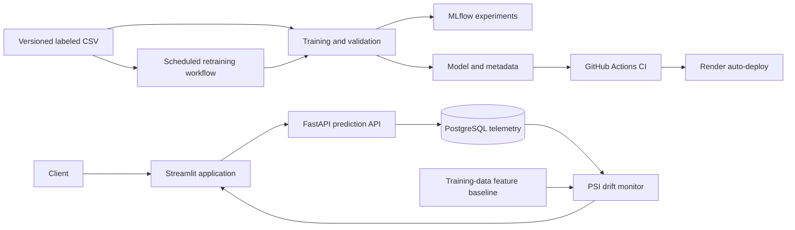

# Customer Churn Prediction Platform

An end-to-end MLOps source project for customer churn prediction. It provides a real-time prediction API, MLflow experiment tracking, prediction telemetry, feature-drift monitoring, a Streamlit dashboard, scheduled retraining, CI, Docker Compose, and a Render deployment blueprint. This public repository does not contain the Telco dataset, trained model, or generated reports; obtain authorized data and train a model locally before running the application.

## Architecture



## Run locally

Use Python 3.11 and PowerShell:

```powershell
python -m venv .venv
.\.venv\Scripts\Activate.ps1
python -m pip install -r requirements.txt
```

The training dataset is not included because the source listing does not provide a redistribution license. Review the terms and follow [data/README.md](./data/README.md) to provide an authorized copy at `data/telco_customer_churn.csv`. Then train the model:

```powershell
python src\train.py
```

Training creates the model and metadata under `models\`. Those artifacts and generated reports are ignored by Git; see [models/README.md](./models/README.md).

Run the API and dashboard in separate terminals:

```powershell
uvicorn app.main:app --reload
streamlit run dashboard.py
```

- API docs and prediction endpoint: `http://127.0.0.1:8000/docs`
- Health/readiness check (model and telemetry database): `http://127.0.0.1:8000/health`
- Monitoring metrics and feature drift: `http://127.0.0.1:8000/monitoring`
- Privacy-safe prediction history: `http://127.0.0.1:8000/prediction-history`
- Historical drift reports: `http://127.0.0.1:8000/drift-history`
- Dashboard: `http://localhost:8501`
- MLflow UI: `mlflow ui --backend-store-uri sqlite:///mlflow.db --host 127.0.0.1 --port 5000`

`POST /predict` accepts the 19 customer input features shown in the OpenAPI schema and returns a prediction ID, churn probability, class, and model version. Customer IDs are rejected and are not returned in history. The API retains a bounded history of model features (for drift calculation) and scores for up to 30 days (maximum 10,000 observations). The `/prediction-history` response exposes only prediction ID, time, predicted class, score, and model version. Configure `PREDICTION_DATABASE_URL` (or the platform-provided `DATABASE_URL`) to connect to PostgreSQL. A local SQLite file remains the fallback when running the API directly without a database URL.

The `/monitoring` endpoint compares the latest 1,000 prediction inputs with the training-data baseline using Population Stability Index (PSI). Drift is flagged at PSI >= 0.2; at least 30 observations are needed before feature-level PSI is reported. Each new prediction window evaluated after that minimum is reached is kept as a bounded historical drift report. API request counts, status-code errors, and response latency are collected for non-monitoring API requests and summarized over the last 24 hours. Drift monitoring currently uses the project's tested PSI implementation; Evidently is not integrated.

The Streamlit app has three views: an overview, an interactive customer-prediction form with privacy-safe recent history, and a separate MLOps monitor for request counts, response time, HTTP errors, prediction activity, PSI drift, model evaluation, and service health. When telemetry is empty, the prediction page can score a synthetic example. Use **Refresh metrics** on the monitoring page to fetch current API data. The API uses PostgreSQL in Docker Compose and Render; direct local runs default to SQLite. Existing SQLite telemetry is not automatically migrated to PostgreSQL. Set `POSTGRES_PASSWORD` in a local `.env` file to replace Compose's development-only default; URL-encode special characters if the password contains them.

## Run with Docker Compose

```powershell
docker compose up --build
```

Provide the authorized dataset and train a model before building the API image. The API and dashboard are available at `http://localhost:8000` and `http://localhost:8501`. PostgreSQL stores prediction, API-request, and drift-report telemetry in the `postgres_data` Docker volume. The Compose database password is for local development only; change it using local environment configuration before sharing the Compose stack.

## Training and experiment tracking

`src/train.py` compares Logistic Regression, Random Forest, and Gradient Boosting using a stratified validation sample from the development cohort. Stable SHA-256 buckets of customer IDs reserve disjoint development, promotion, and final test cohorts; promotion and test customers are excluded from model fitting. The automated non-regression gate compares candidate and champion F1 on the reserved promotion cohort. The final test metrics are calculated once after promotion and are not used to choose or promote models. The split scheme is recorded in metadata; an older champion without this metadata must first be replaced by a reviewed training run before automated promotion is enabled.

The scikit-learn version is pinned for model serialization compatibility, included in metadata, and checked when the API loads the artifact. Model files use Python pickle-compatible serialization; only load artifacts produced by a trusted training run.

Set `CHURN_DATA_PATH` to use a different labeled CSV and `MLFLOW_TRACKING_URI` to connect to a remote MLflow tracking server. The CSV must contain `customerID`, `TotalCharges`, and `Churn` as well as the model feature columns. The training script records the dataset SHA-256 in the model metadata.

GitHub Actions runs tests (including a PostgreSQL telemetry round-trip), validates Docker Compose, and builds both service images on pushes and pull requests using test fixtures. The scheduled retraining workflow skips when the dataset is absent; provide an authorized dataset through an appropriate private data source before enabling retraining. When data is supplied, the workflow checks for a changed data hash and only publishes a candidate that does not regress on the reserved promotion cohort. Configure the GitHub Actions secret `MLFLOW_TRACKING_URI` to persist automated-run experiment history in a remote MLflow server; without it, tracking remains in the short-lived runner.

**Real-world limitation:** the supplied Telco CSV is a static labeled sample. Real supervised retraining requires a governed process to deliver new, quality-checked labels into the training dataset; prediction requests alone are not labels and must never be treated as such. This project does not infer outcomes from unlabelled predictions.

## Render deployment

The `render.yaml` blueprint defines the API, a managed PostgreSQL database, and the monitoring dashboard. The public source repository does not include the dataset or trained model, so a deployment built directly from it will not become healthy until you provide those assets to the build using an authorized, controlled distribution method. Do not commit restricted data or model artifacts to a public repository. To deploy after arranging asset provisioning:

1. Push this project to a GitHub repository and connect that repository to Render.
2. Create a Render Blueprint from the repository and review the costs for the web services and managed PostgreSQL instance before applying.
3. Confirm the API URL referenced by `API_URL` in `render.yaml` matches the URL Render assigns.
4. Configure the GitHub Actions workflow permissions to allow its retraining job to push model artifacts. Render auto-deploys commits to the connected branch.
5. After deployment, verify `/health`, `/docs`, and the dashboard URL.

The blueprint is configuration only; it does not create cloud resources until applied in a Render account. This demonstration has no authentication or rate limiting and must not be exposed to untrusted traffic or supplied with production customer data without those controls, TLS/routing review, access controls, and a privacy-retention review. Do not commit credentials.

## Validation

```powershell
pytest -q
docker compose config
```

The IBM Telco sample dataset may have redistribution terms; verify the source and license before using or redistributing it. The dataset and its trained artifact are excluded from this public repository.
